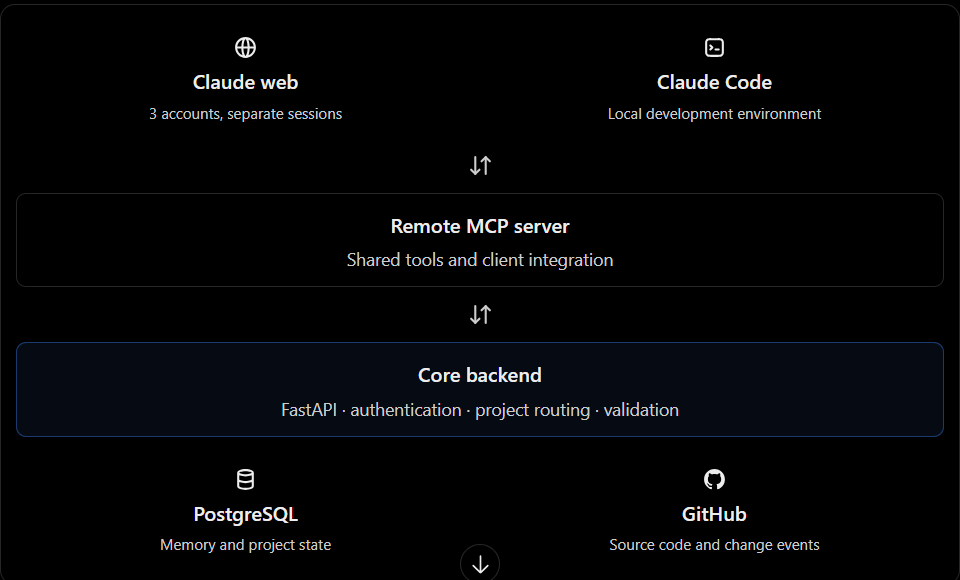

working on one project through diff claude accounts get though as project racking gets tough between diff sessions in diff accounts
Making a common shared platform for all claude accounts to track projects in one place 
A tested, cross-client synchronization system with conflict handling and reliable change tracking is much more compelling than a basic RAG chatbot.
Which supports both local and web claude
Sharing memory is not the same as automatically synchronizing every change. You'll need separate mechanisms for Git events and local filesystem changes if you want those tracked without asking Claude to report them.

1. Cross-session change tracking
Know what changed, which account made the change, which files were affected, whether the work was committed, and what still needs verification.
2. Project-aware handoffs
Account B shouldn't just receive a pile of memories. It should know the current state, blockers, completed tasks, and the next logical action.
3. Provenance and conflict detection
Distinguish verified facts from an account's assumptions. Detect when two accounts modify the same task or record contradictory decisions.
4. One memory layer across clients the same project state should work in Claude web, Claude Code, and potentially other MCP-compatible coding agents later.

-Cross-account continuity: one account records a decision and another can retrieve it correctly.
-Cross-surface continuity: the same information works from both Claude web and Claude Code.
-Reliable handoff: the next account can identify unfinished work and distinguish committed changes from uncommitted or unverified work.

There are four distinct responsibilities:
- Claude clients: request information and submit updates.
- MCP: makes your backend's capabilities available as tools in Claude.
- FastAPI: enforces permissions and implements the memory and project logic.
- Database: stores the shared information persistently.

One important detail: Claude web and Claude Code may have different connector setup requirements, so we'll test each client independently. We should not assume that connecting one account automatically connects the others.

Claude web
In each account, open Claude and:
1. Go to Settings → Connectors.
2. Choose Add custom connector and enter the remote MCP server URL.
3. Complete the authentication setup.
4. Open a chat and enable the connector from the tools or connectors menu.
5. Ask Claude to retrieve the project state or save a handoff.

There are four distinct responsibilities:
- Claude clients: request information and submit updates.
- MCP: makes your backend's capabilities available as tools in Claude.
- FastAPI: enforces permissions and implements the memory and project logic.
- Database: stores the shared information persistently.

Problem 1: Two agents disagree, and nobody notices.

Say you are chatting with Claude in Account A, and Account B is working on the same project.

Account A records the decision “Use Postgres” on the topic “Database”.
Account B, without having read A’s decision, records “Use SQLite” on the same topic.

Before Phase 7, the next session sees both decisions and has to guess which is current. After Phase 7, get_project_state puts this at the top:

conflicts: [ Database: two different decisions — #12 "Use Postgres", #15 "Use SQLite" ]

If owner, call resolve_decision_conflict(keep=12). Decision 15 is marked superseded, the conflict disappears, and future sessions see only “Use Postgres”